  
  
  

**Solutions Engineer at [Datasembly](https://www.datasembly.com/)**, based in Canada. Previously at Amazon Prime Video.

I like turning ambiguous questions into working systems — then testing the results and writing down what I learned.

## 🧭 Start here

<table>
  <tr>
    <td width="50%" valign="top">
      <h3>🛩️ <a href="https://github.com/kmsmohamedansar/agent-flight-recorder">Agent Flight Recorder</a></h3>
      A local recorder for AI-agent tool calls and file changes, with replay and evidence-backed failure investigation.  
      
    </td>
    <td width="50%" valign="top">
      <h3>📚 <a href="https://github.com/kmsmohamedansar/storyera">StoryEra</a></h3>
      A reusable agent skill that audits novel continuity, cites the evidence, and suggests repairs without editing the manuscript.  
      <code>agent skill</code> <code>evaluation</code>
    </td>
  </tr>
  <tr>
    <td width="50%" valign="top">
      <h3>🔬 <a href="https://github.com/kmsmohamedansar/rea-study">REA Study</a></h3>
      An independent evaluation of a tool for inspecting programs without source code, with raw results and a claims ledger.  
      <code>research</code> <code>reverse engineering</code>
    </td>
    <td width="50%" valign="top">
      <h3>🔌 <a href="https://github.com/kmsmohamedansar/integration-in-a-box">Integration-in-a-box</a></h3>
      A synthetic two-company integration with real authentication, signed webhooks, and ten deliberate failures with runbooks.  
      <code>auth</code> <code>webhooks</code> <code>runbooks</code>
    </td>
  </tr>
  <tr>
    <td width="50%" valign="top">
      <h3>🚚 <a href="https://github.com/kmsmohamedansar/data-delivery">Data Delivery</a></h3>
      A tested pipeline that turns messy weekly files into a clean table and blocks delivery when checks fail.  
      <code>data quality</code> <code>pipelines</code>
    </td>
    <td width="50%" valign="top">
      <h3>🗿 <a href="https://github.com/kmsmohamedansar/ai-digital-double">AI Digital Double</a></h3>
      A 3D model of my head made from phone imagery, with the process and failures documented.  
      <code>3D</code> <code>photogrammetry</code> <code>Blender</code>
    </td>
  </tr>
</table>

## 📱 Shipped on the App Store

- ✍️ **[Haloscript](https://apps.apple.com/ca/app/haloscript/id6820670080)** — a writing app for Mac, iPad, and iPhone.
- 🏋️ **[RepTrack](https://apps.apple.com/us/app/reptrack-workout-log/id6761032027)** — a local-first workout log.

**More work:** [Site Recon](https://github.com/kmsmohamedansar/site-recon) · [Authorized Web Exposure Audit](https://github.com/kmsmohamedansar/authorized-web-exposure-audit) · [Decision Models](https://github.com/kmsmohamedansar/decision-models) · [Sitescout](https://github.com/kmsmohamedansar/sitescout) · [full portfolio →](https://ansarbuilds.dev/#work)

## 🛠️ Tools I use

  

| Area | Stack |
|---|---|
| **Data** | SQL · Snowflake · Python · DuckDB · dbt · Dagster · Airflow · BigQuery · Tableau · Power BI |
| **Building** | SwiftUI · SwiftData · TypeScript · React · Next.js · SQLite · Docker · Playwright · Blender |
| **AI** | Model Context Protocol · agent skills · Claude Code · Codex · Cursor |

> [!NOTE]
> Some projects use synthetic data to respect employer and client confidentiality. AI coding tools can accelerate implementation; I remain responsible for problem definition, architecture, testing, review, and final decisions.

  If a project interests you, <a href="mailto:mohamedansarkms@gmail.com"><b>get in touch</b></a> ✦

<!-- The banner is generated by assets/generate_banner.py -->
